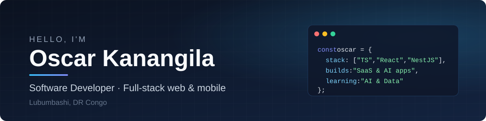

  

  <h1>Hi, I'm Oscar Kanangila 👋</h1>
  
<b>Software Developer</b> · Full-stack web & mobile · Lubumbashi, DR Congo 🇨🇩

  

    
    
    
  

---

## About me

I build business software, SaaS products and AI-powered applications — from the database to the mobile app.

- 💼 **Software Developer at Auto Lubumbashi** — I design and maintain the internal platforms used by 500+ employees across several companies in Lubumbashi, Kolwezi and Likasi.
- 🧠 Currently exploring **RAG, LLM tooling and data science**.
- 🎓 B.Sc. in Computer Science (System & Network Administration) — University of Lubumbashi.
- 🌍 Former **Google Developer Student Club Lead** (2024) and in-house trainer.
- 💬 I speak French and English.

## What I've built

| Project | What it does | Impact |
|---|---|---|
| **PeopleHub** | Multi-company HR platform — dashboards, attendance (incl. GPS), large datasets | 4+ companies, 500+ employees |
| **Questify** | 360° evaluation & survey platform with anonymity and weighted results | ~800 employees |
| **IT Service Ticket / IT Preventive** | Service requests and preventive maintenance tracking | 500+ pieces of equipment |
| **Complainte Client** | Customer complaint management | 1,000+ complaints / year |
| [**RAGify**](https://github.com/Os-humble-man/RAGify) | Chatbot that answers questions from company documentation (RAG, pgvector, streaming) | Open source |
| [**engineering-labs**](https://github.com/Os-humble-man/engineering-labs) | Small hands-on labs to learn backend concepts (gRPC, tRPC…) | Open source |

## Tech stack

**Languages** 

**Frontend & mobile** 

&nbsp;React Native · Expo · Shadcn UI · TanStack Query · Zustand

**Backend** 

&nbsp;REST · RPC · JWT · Swagger

**Data & DevOps** 

&nbsp;pgvector · PM2 · CI/CD

## GitHub activity

  

## Latest blog posts

<!-- BLOG-POST-LIST:START -->
- [Getting started with Adonis.js: A robust Node.js framework for web development](https://dev.to/oshumbleman/getting-started-with-adonisjs-a-robust-nodejs-framework-for-web-development-4ipj)
- [10 jeux pour s’améliorer en CSS](https://dev.to/oshumbleman/10-jeux-pour-sameliorer-en-css-1o25)
<!-- BLOG-POST-LIST:END -->

---

  Open to collaborations on SaaS, internal tools and AI projects — feel free to reach out on LinkedIn.

